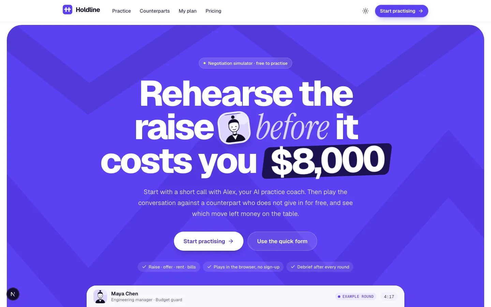
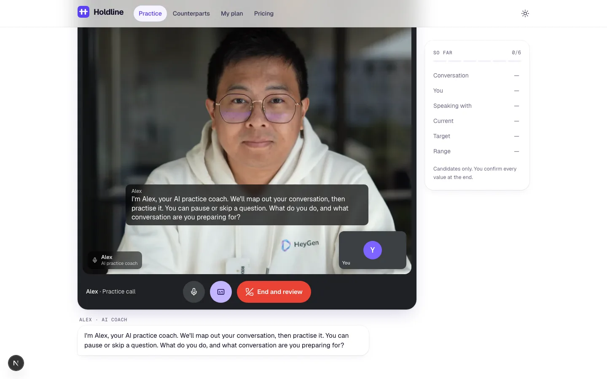
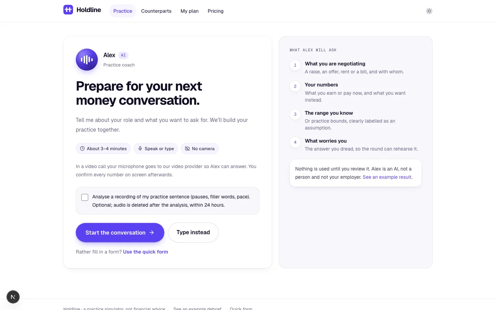
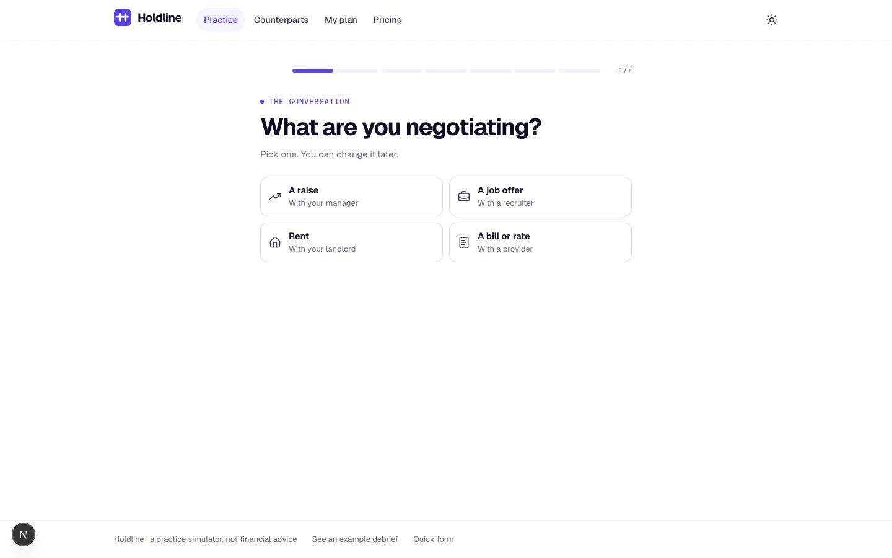
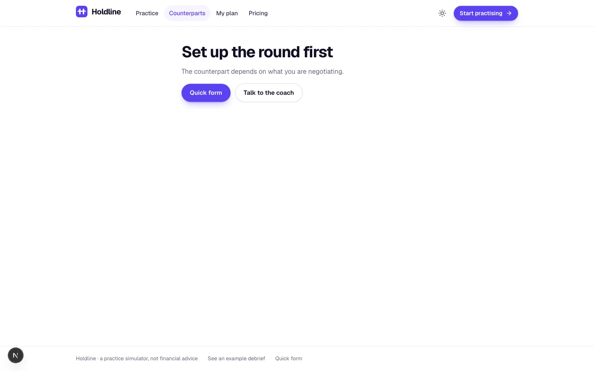
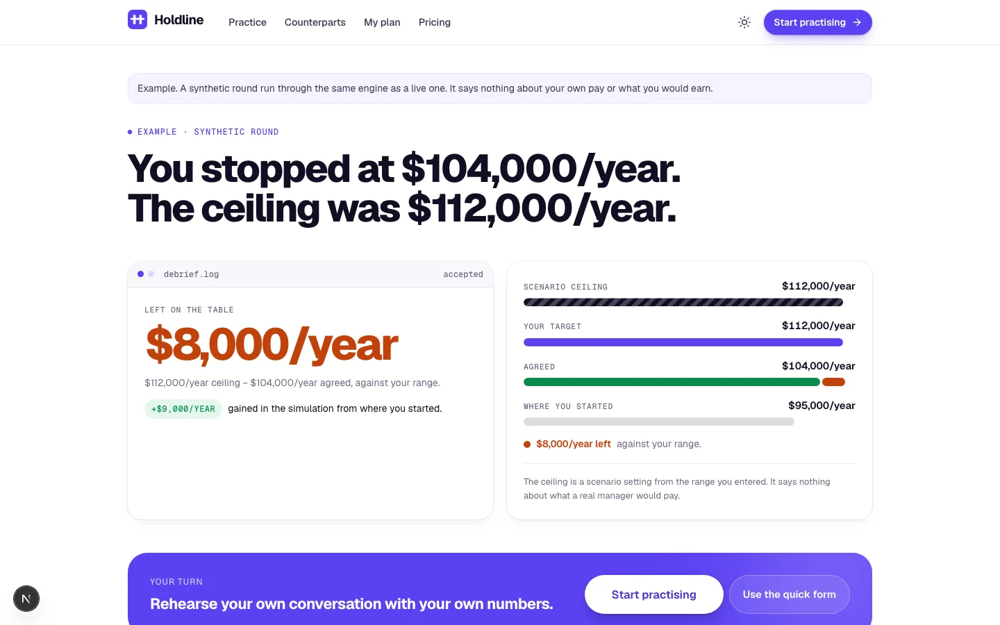
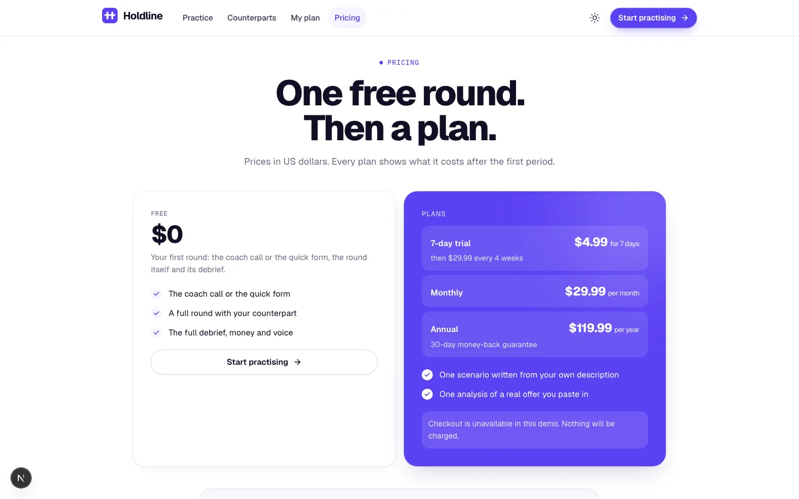
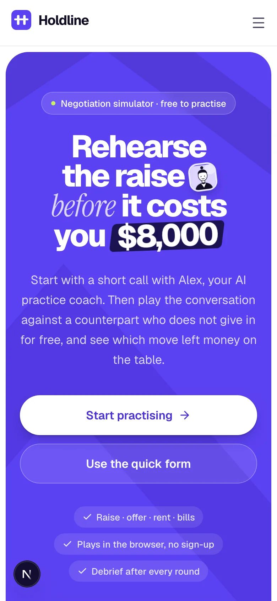

<p align="center">
  <picture>
    <source media="(prefers-color-scheme: dark)" srcset="docs/brand/logo-dark.svg">
    
  </picture>
</p>

<h1 align="center">Holdline</h1>

<p align="center">
  <a href="https://holdline.aqy.kz"></a>
  <a href="https://github.com/Kirirto-kun/project_temp/commits/main"></a>
  
  <br>
  
  
  
  
  <br>
  
  
  
  
</p>

<p align="center"><b>Rehearse the raise before it costs you $8,000.</b><br>
A short call with Alex, your AI practice coach, then the real conversation against a counterpart who does not give in for free.</p>

<p align="center"><br>
<sub>The landing page. No sign-up: everything runs in the browser as a guest.</sub></p>

<p align="center"><br>
<sub><b>A video call, not a form.</b> Alex is a talking avatar in a Meet-style room: live captions, a self tile with the camera off,
mute, captions and end controls. Every number Alex hears lands in the brief on the right, and nothing is used until you confirm it.</sub></p>

Holdline is a practice simulator for money conversations: **a raise, a job offer, rent or a bill**. You tell the coach
your situation (by video call, voice or text), confirm the numbers, then play the conversation against one of four
counterparts with their own style. After every round the debrief shows, move by move, how much you left on the table
against your own range.

The negotiation is decided by a **deterministic TypeScript engine**. Language models only label your reply, phrase the
counterpart's line and write debrief comments; **every amount on screen is computed by code** from your own range.
Without any API key the product still runs end to end with a rule-based classifier and templates.

Contents: [features](#feature-tour) - [how it works](#how-it-works) - [run locally](#run-locally) -
[configuration](#configuration) - [tests](#tests) - [deploy](#deploy) - [repo layout](#repo-layout) - [honest limits](#honest-limits)

## Feature tour

### 1. Meet the coach

<table>
<tr>
<td align="center" valign="top"><br><sub><b>Alex, the practice coach.</b> Four questions: what you negotiate, your numbers, the range you know, what worries you. Video, voice or typing; about 3–4 minutes.</sub></td>
<td align="center" valign="top"><br><sub><b>Or the quick form.</b> The same brief in seven taps, for people who would rather not talk.</sub></td>
</tr>
</table>

| How you talk to Alex | What happens |
|---|---|
| **Video call** | LiveAvatar FULL hears you; each final transcript goes to our server, the coach answers, and the avatar says the line. |
| **Voice call** | Audio-only call over WebRTC; transcripts are committed server-side before any value is extracted. |
| **Text chat** | Type, or press the mic and dictate. Alex's replies are read aloud (ElevenLabs), with a mute toggle and replay on every line. |

If a call cannot start or drops, the screen falls back to the next mode (video → voice → text) and keeps every answer.

### 2. Pick a counterpart and play the round

<table>
<tr>
<td align="center" valign="top"><br><sub><b>Four counterparts, four ways to say no.</b> Budget guard, analyst, relationship builder, hardliner.</sub></td>
<td align="center" valign="top"><br><sub><b>The debrief.</b> Where you started, what you agreed, the scenario ceiling, and the money left on the table.</sub></td>
</tr>
</table>

The round is a five-minute negotiation. Speak to the counterpart **as a video avatar** (each persona has its own face and
voice), talk by voice, or type with dictation and read-aloud. Trust and patience move with what you say; the offer only
moves when the engine says so.

### 3. Keep practising

<table>
<tr>
<td align="center" valign="top"><br><sub><b>Pricing.</b> Practising is free. Polar checkout opens only when you click a plan; there is no paywall in the flow.</sub></td>
<td align="center" valign="top"><br><sub><b>Phone-first.</b> Every screen works at 360 px.</sub></td>
</tr>
</table>

## How it works

```
Browser (Next.js 16, React 19)
 ├─ Landing · quick form · coach (video / voice / text) · counterparts · round · debrief · plan · pricing
 ├─ LiveAvatar Web SDK (FULL): avatar video + speech recognition; lines spoken with repeat()
 ├─ Dictation (ElevenLabs Scribe, browser fallback) and read-aloud (ElevenLabs TTS, browser fallback)
 └─ Optional on-device body-language step (MediaPipe in a worker; nothing uploaded)

Server (Next.js route handlers)
 ├─ /api/intake/**                    coach: create, connect (audio | video), turn, transcript, tools, stop, confirm
 ├─ /api/session, /api/turn           round pipeline: classify → deterministic engine → actor → commit
 ├─ /api/session/:id/video[/stop]     counterpart avatar call: token per persona, budget hold, settle
 ├─ /api/speech/{transcribe,say}      dictation and read-aloud for server-owned lines only
 ├─ /api/debrief                      money computed by code; comments labelled as model output
 ├─ /api/polar/**, /api/entitlement   checkout from /pricing, signed webhooks
 └─ guest owner cookie, same-origin checks, per-IP daily quotas, global daily spend ceiling
```

- **Money is code.** Amounts are integer minor units; the engine (`src/engine`) owns every transition. Models choose among
  amounts the parser already found and never invent one.
- **Calls are guarded.** No paid session before Start; one attempt per click; 5-minute limit per intake that a reconnect
  does not reset; late events from a closed call change nothing; End, review and delete always stop the provider session.
- **Keys stay on the server.** The browser only ever gets short-lived session tokens.

## Run locally

Requires Node 22+.

```bash
npm ci
cp .env.example .env.local
npm run dev
```

Open <http://localhost:3000>. With an empty `.env.local` the app runs with in-memory storage, the deterministic
classifier and the text coach. `GET /api/config` shows which capabilities are on.

## Configuration

| Capability | Needs |
|---|---|
| Model-assisted classifier, actor, debrief, coach reading | `ANTHROPIC_API_KEY` |
| Video avatar (coach and counterparts) | `AVATAR_CALL=dev\|on`, `LIVEAVATAR_API_KEY`, `LIVEAVATAR_AVATAR_ID`, `LIVEAVATAR_VOICE_ID` ([setup](docs/operations/avatar-call.md)) |
| Dictation and read-aloud in text chats | `ELEVENLABS_API_KEY` (optional `ELEVENLABS_VOICE_MAP`, `ELEVENLABS_TTS_MODEL`) |
| Voice practice in the round | `ELEVENLABS_API_KEY`, `ELEVENLABS_AGENT_ID`, `ELEVENLABS_CUSTOM_LLM_SECRET` |
| Coach audio call | `OPENAI_API_KEY`, `OPENAI_REALTIME_MODEL` |
| Body language on camera | `VISUAL_INTAKE=1` and `npm run vision:assets` once |
| Payments | `POLAR_*`, Redis, `APP_URL` |

In production every paid provider stays off until `DAILY_BUDGET_USD` is set. `AVATAR_CALL=dev` is refused in production;
`AVATAR_CALL=on` also needs `LIVEAVATAR_AVATAR_APPROVED=true`. Voice for the avatar: `npm run avatar:setup-voice`
(add `-- --sandbox` for the free sandbox voice).

## Tests

```bash
npm run lint && npm run typecheck
npm run test:engine && npm run test:server && npm run test:ui && npm run test:intake
npm run build && npm run test:e2e
```

| Suite | Covers |
|---|---|
| `test:engine` | contracts, money, every engine transition and invariant, 30 labelled classifier replies, actor money guard, debrief |
| `test:server` | transactions, idempotency, concurrency, access, quotas, budget, payments, avatar round calls, speech routes |
| `test:ui` | screens, dictation and read-aloud hooks, round avatar controller |
| `test:intake` | extraction scenarios, coach flow, video and audio call lifecycle, Meet-style call room, body-language pipeline |
| `test:e2e` | quick form → round → debrief → replay, coach → practice, text fallback, paid API protection |

Paid live checks run separately (`npm run test:classifier:live`); offline mocks are never counted as a live avatar call.

## Deploy

Production runs at **<https://holdline.aqy.kz>** as one Docker container behind Caddy.

```bash
cd ~/holdline && git -C src pull && docker compose up -d --build
```

See [docs/operations/setup.md](docs/operations/setup.md) and the [release checklist](docs/operations/release.md).

## Repo layout

| Path | What lives there |
|---|---|
| `src/engine` | `createInitialState`, `applyMove`, `finishSession`: the deterministic negotiation core |
| `src/domain` | money in integer cents, amount parser, debrief math, handoff validation |
| `src/scenarios` | raise / offer / rent / bill objections, four archetypes, the counterparts |
| `src/intelligence` | classifier, actor + money guard, scenario writer, debrief, model port |
| `src/onboarding` | the coach: contracts, extraction, interviewer, video/audio/text calls, review |
| `src/server` | platform: storage, access, limits, round pipeline and video, speech, payments |
| `src/components/holdline` | brand components: logo, nav, avatars, the Meet-style `CallStage` |
| `src/app`, `src/features`, `src/client` | pages, screens, browser capture and voice hooks |
| `docs` | plans, operations runbooks, brand assets, screenshots |

## Honest limits

- The counterpart's limit is a scenario setting from your range, not knowledge of a real budget.
- The stock avatars used for the video calls are photorealistic provider avatars; the free LiveAvatar sandbox allows one
  avatar and one-minute sessions. Production avatars need approval (`LIVEAVATAR_AVATAR_APPROVED`).
- Voice metrics are measurements (pace, pauses, fillers, pitch); no emotion, nerves or stutter diagnosis.
- Raw audio is never kept longer than 24 hours; dictation audio is not stored at all.
- The guest identity is a browser cookie: a purchase lives in that browser.

<p align="center"><sub>Built for Business Cup 2.0. A practice simulator, not financial advice.</sub></p>
