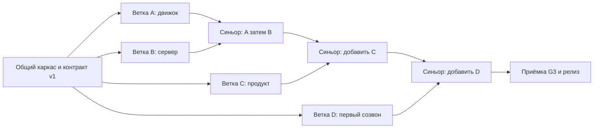

# Holdline. План 2 из 4. Сервер, голосовые сервисы и интеграция

> **For agentic workers:** REQUIRED SUB-SKILL: Use superpowers:subagent-driven-development (recommended) or superpowers:executing-plans to implement this plan task-by-task. Steps use checkbox (`- [ ]`) syntax for tracking.

**Goal:** предоставить устойчивые API для движка переговоров и инфраструктуру первого созвона, подключить голос/оплату и собрать четыре ветки в проверенный production-релиз.

**Architecture:** Next.js Route Handlers вызывают функции A через общий pipeline и сохраняют состояние в общем хранилище. ElevenLabs и текстовый режим используют этот pipeline; C получает публичное состояние через API. Сервер отвечает за авторизацию гостевых сессий, повторы запросов, расходы и очистку аудио.

**Tech Stack:** Next.js, TypeScript, Zod, Redis/Upstash, ElevenLabs Agents/Scribe, приватное S3-совместимое хранилище, Polar; Vitest и Playwright. Версии SDK и runtime закрепляются в lockfile после проверки совместимости.

**Spec:** [PLAN.md](../../../PLAN.md), особенно §4–8, §12–15; [контракт и правила A](2026-11-15-01-engine.md), [план C](2026-11-15-03-product.md), [первый созвон D](2026-11-15-04-avatar-intake.md).

**Разработчик:** B. **Ветка:** `codex/holdline-platform`. **Синьор:** владелец слияний и релизного решения; B готовит ему технические материалы.

## Общие ограничения

- Основной путь без логина; сервер всё равно проверяет принадлежность сессии гостевому посетителю.
- «Сессия ≤ 5 минут», «≤ 3 сессии на IP в день», глобальный дневной потолок расходов.
- Ключи сервисов только на сервере; никаких секретов в `NEXT_PUBLIC_*`.
- Временное аудио удаляется не позднее 24 часов; клон голоса — после сессии, если функция вообще включена.
- Текстовый fallback проходит через тот же движок и сохраняет уже пройденные ходы.
- «Заморозка функций в H+17» относится к исходному хакатонному объёму. Новая D проходит G0…G3; платёжные P2 включаются после отдельной приёмки.
- Вводный звонок имеет свою квоту и состояние, общие расходы ограничиваются тем же серверным бюджетом. Lifecycle и Python worker D принимаются вместе с Next.js, а не как забытый внешний прототип.

## На что обратить внимание при ревью

1. Повтор запроса, конкурентный ход и tentative-транскрипция не применяют один ход дважды — B2/B3.
2. Подмена sessionId, callback и browser paid-флага не открывает чужие данные/платные функции — B2/B6.
3. Serverless restart, несколько экземпляров сервера и истёкшая сессия не дают «исчезающий» или противоречивый state — B1/B2.
4. Сбой LLM, Scribe, загрузки или SSE не теряет уже зафиксированную сделку — B2–B5.
5. Под общим IP жюри и повторными webhook лимиты остаются управляемыми, а выдача покупки — однократной — B5/B6.

## 1. Границы ответственности и общий старт

B владеет `src/server/**`, `src/app/api/**` **кроме `api/intake/**`**, `tests/server/**`, корневыми конфигами, npm lockfile, CI, env, README и `docs/operations/**`. A владеет общими схемами/формулами, C — оболочкой/тренировкой и reusable аудио. D владеет `src/onboarding/**`, API/pages intake, `services/intake-agent/**` и его отдельным Python uv.lock. B предоставляет D storage/auth/queue/budget/audio и deployment, не дублирует его endpoints и автоматы.

Задача до разделения на четыре ветки:

- [ ] Подготовить базовый каркас Next.js App Router с `src/`, strict TS, Tailwind, алиасом `@/*` и Vitest/Playwright.
- [ ] Зафиксировать npm и совместимые Node/Next/SDK в одном npm lockfile. Отдельный Python worker D использует uv/pyproject/uv.lock; зафиксировать Python runtime и контейнерный образ. Это отдельная служба, не второй менеджер одного приложения.
- [ ] Включить UI/audio-зависимости C, валидаторы A и LiveKit/MediaPipe-зависимости D; корневые зависимости меняет B по запросу владельца.
- [ ] Принять схемы и fixtures A; экспортировать API-заглушки со статусом неготовности. Тестовый fixture-режим явно отделить от production.
- [ ] Создать команды lint/typecheck/test:engine/test:server/test:ui/test:intake/test:e2e/test:classifier:live/build. Python: `uv sync --frozen --project services/intake-agent`, `uv run --project services/intake-agent pytest`.
- [ ] В `test:engine` включить tests/contracts, tests/engine и tests/intelligence; команды server/UI запускают свои каталоги. Пустой каталог не считается доказательством готовности функции.
- [ ] Синьор фиксирует базовый SHA в main. От него создаются `codex/holdline-engine`, `codex/holdline-platform`, `codex/holdline-product`, `codex/holdline-avatar-intake`. Для уже начатых веток — ранний общий коммит расширений A8/B9/C9, затем обновление всех веток.

Независимая работа B проверяется внедрёнными fake ModelPorts/engine с fixtures A. Реальный composition root — `src/server/dependencies.ts`; он импортирует экспортированные A функции. Runtime приложения не должен незаметно подменять их моками. C разрабатывает экраны на тех же fixtures и после интеграции переключается на реальные API.

## 2. API и границы доверия

### Общие правила транспорта

- Все браузерные API same-origin, JSON UTF-8; общие DTO из `src/contracts/api.ts`, локальные intake DTO из `src/onboarding/contracts`. Worker использует отдельную сервисную авторизацию. Схемы валидируются на границе; время сервера — ISO UTC, аудиовремя — миллисекунды от начала записи.
- Ответы с данными сессии, токенами и entitlement: `Cache-Control: no-store`; callback провайдера имеет отдельную сервисную авторизацию.
- Гостевой посетитель получает случайный непрогнозируемый owner token в HttpOnly/Secure/SameSite=Lax cookie. Сервер хранит связь owner→sessions; sessionId сам по себе не является разрешением доступа. Для мутаций проверяются Origin и принадлежность ресурса.
- На пользовательских POST, создающих сессию, ход, анализ, checkout или генерацию, обязателен `Idempotency-Key`. Для хода он равен `turnId`. Один ключ с другим телом → 409. Повтор завершённого запроса возвращает сохранённый результат.
- Общая ошибка: `{error:{code, message, retryable, requestId, currentVersion?}}`. 400 invalid input, 401 invalid service auth, 404 unknown/not owned, 409 version/key conflict, 410 expired, 413 upload too large, 429 limit, 503 upstream unavailable/feature disabled. Платное действие без права → 403 `ENTITLEMENT_REQUIRED`.
- Ошибка не содержит промптов, ключей или записи разговора. Для 429/временного 503 передаётся Retry-After, если известен.

### Согласованные эндпоинты

Таблица определяет обязанности B; A добавляет соответствующие схемы в общий контракт до реализации потребителя. `SessionView`, `Debrief`, `AudioManifest` и единицы сумм определены в плане 1.

| Метод и путь | Вход | Успешный ответ и поведение |
|---|---|---|
| `GET /api/config` | — | `{contractVersion:1,intakeContractVersion:1,capabilities:{voice,rent,offer,bill,plan,customScenario,offerAnalysis,voiceClone,payments,avatarIntake,visualIntake},sessionLimitSeconds:300,intakeLimitSeconds:300,paidProduct:{productKey,priceMinor,currency:'USD',billing:'one_time'}\|null}`; только готовые возможности, без секретов |
| `POST /api/session` | `{quiz:QuizAnswers, baselineId:string\|null}`, для стандартных kind | 201 `{session:SessionView}`; сервер сохраняет scenarioSnapshot; quiz.kind=custom здесь запрещён |
| `GET /api/session/:id` | owner cookie | 200 `{session:SessionView}`; polling C только при активной сессии, примерно раз в секунду |
| `POST /api/turn` | `{sessionId, turnId, expectedVersion, text}` | 200 `{session:SessionView, committedTurnId}` после атомарной фиксации одного текстового хода |
| `POST /api/session/:id/finish` | `{expectedVersion, reason:'stopped'}` | 200 `{session:SessionView}`; повтор безопасен, уже принятая сделка не превращается в stopped |
| `POST /api/session/:id/mode` | `{expectedVersion,mode:'text'\|'voice'}` | 200 `{session:SessionView}`; атомарно сменить транспорт и отозвать старый binding; при незавершённом ходе 409 `TURN_IN_PROGRESS` |
| `POST /api/session/:id/replay` | `{baselineId:string\|null}` | 201 `{session:SessionView}`; новый id/replayOf, сохранённый сценарий и initialState, новая квота |
| `POST /api/debrief` | `{sessionId}` | 200 `{debrief:Debrief}`; только завершённая сессия. Денежная часть готова сразу; voice может быть pending/unavailable |
| `POST /api/elevenlabs/token` | `{sessionId, connectionType:'webrtc'\|'websocket'}` | WebRTC: `{connectionType,conversationToken,voiceId,sessionBinding,session:SessionView}`; WS: `{connectionType,signedUrl,voiceId,sessionBinding,session:SessionView}`. Только activeMode=voice; binding привязан к transportEpoch |
| `POST /api/llm/v1/chat/completions` | OpenAI-compatible запрос Agent, extra body с sessionId/binding, сервисный секрет | 200 SSE с проверенным ответом актёра; не выдаёт CoreState в поток речи |
| `POST /api/audio/uploads` | `{purpose,mimeType,bytes,sessionId:string\|null,intakeId:string\|null}` по discriminated AudioManifest A | 201 `{audioId,uploadUrl,expiresAt}`; проверить владельца соответствующего ресурса и согласие для intake |
| `POST /api/audio/:audioId/complete` | `{manifest:AudioManifest}` | 200 `{audioId,status:'uploaded'}` после проверки объекта, владельца и manifest |
| `POST /api/voice/baseline` | `{audioId}` | 200 `{baseline:VoiceBaseline}`; duration около 20 секунд, отдельно проверяется достаточность речи |
| `POST /api/voice/analyze` | `{sessionId,audioId,baselineId:string\|null}` | 202 `{analysisId,status:'pending'}`; запуск долговечной задачи с идемпотентностью |
| `GET /api/voice/analyses/:id` | owner cookie | 200 `{analysisId,metrics:VoiceMetrics}`; C повторяет запрос до terminal status |
| `POST /api/polar/checkout` | `{productKey:'conversation_pack'}` | 201 `{checkoutUrl,checkoutId}`; цена/продукт выбираются сервером |
| `POST /api/polar/webhook` | raw body и подпись Polar | 2xx только после надёжной записи события; проверка подписи, дедупликация, server entitlement |
| `GET /api/entitlement` | owner cookie | `{status:'none'\|'pending'\|'active'\|'revoked', customScenariosRemaining, offerAnalysesRemaining}` |
| `POST /api/scenarios/custom` | `{quiz:QuizAnswers, description}` | 201 `{scenarioId}`; списывает право ровно один раз после успеха, стандартный POST session принимает этот id через отдельную валидируемую ветку запроса |
| `POST /api/offers/analyze` | `{text,currency:'USD',period}` | 200 `{analysis:OfferAnalysis}`; server entitlement и отдельная квота |

`POST /api/session` имеет взаимоисключающие формы `{quiz,baselineId}`, `{customScenarioId,baselineId}` и `{intakeId,profileRevision,avatarId,baselineId}`. Для intake сервер вызывает D `getConfirmedHandoff(intakeId,ownerId)`, проверяет актуальную подтверждённую profileRevision, затем A buildQuizAnswers. При неполноте — 400 с missingFields; при устаревшем подтверждении — 409. Ответы/флаг confirmed из браузера не заменяют серверный handoff. sourceIntakeId выставляет только сервер; в прямом quiz его нельзя подделать. Custom требует прежнее entitlement, любой intake с kind=custom направляется в защищённый flow. Клиент не передаёт reservation/trust/промпты. voiceId — публичный разрешённый ID, не API-ключ.

Все `/api/intake/**` реализует D по таблице четвёртого плана; B повторно их не создаёт. Перед запуском переговорного Agent сервер убеждается, что intake media завершена; зависшая комната закрывается через порт D, и только после подтверждения закрытия выдаются новые голосовые credentials.

IVC отключён по умолчанию. Если эта P2-функция принята, B добавляет отдельные `POST /api/voice/clone`, `POST /api/voice/clone/speak`, `DELETE /api/voice/clone/:id` со схемой согласия, owner-проверкой и автоматической очисткой. Без этой вертикали C не показывает кнопку клонирования.

## 3. Задачи ветки B

### B1. Инфраструктура и состояние

**Файлы:** создать `src/server/{env,dependencies}.ts`, `src/server/storage/{sessions,redis,audio}.ts`, `src/server/access/visitor.ts`, `src/app/api/config/route.ts`, `.env.example`, `.github/workflows/ci.yml`, `docs/operations/setup.md`, `tests/server/storage.test.ts`.

**Принимает:** типы и серверные экспорты A. **Отдаёт:** постоянное состояние между запросами, CI, preview/prod-конфигурацию.

- [ ] Реализовать атомарные create/read/compare-and-set сессии и дедупликацию запросов в Redis/Upstash. `version` увеличивается при каждой зафиксированной мутации.
- [ ] Отделить deadline разговора 300 секунд от срока хранения сессии 24 часа: разбор/переигровка доступны после конца разговора; после удаления — 410 и понятное сообщение.
- [ ] В production запретить in-memory adapter и fixture mode. Проверить чтение сессии вторым экземпляром сервера и восстановление после restart.
- [ ] Секреты описать в `.env.example` пустыми значениями: LLM key/model IDs, ELEVENLABS_API_KEY/AGENT_ID/custom LLM secret, Redis, object storage, Polar, cookie/binding signing secret, дневные budgets. Ни одного рабочего значения в Git.
- [ ] Создать deploy pipeline и открытый для жюри HTTPS URL. Проверить, что нет защиты логином хостинга, блокирующей callback Agent и обычный браузер.
- [ ] Выполнить `npm run test:server -- --run tests/server/storage.test.ts`, `npm run typecheck`, `npm run build`; подтвердить чтение из общего storage на preview.

### B2. Один транзакционный pipeline и текстовый путь

**Файлы:** создать `src/server/session/{create,process-turn,finish,replay,mode,view}.ts`, `src/server/llm/provider.ts`, `src/app/api/session/route.ts`, `src/app/api/session/[id]/route.ts`, `src/app/api/session/[id]/{finish,replay,mode}/route.ts`, `src/app/api/{turn,debrief}/route.ts`, `tests/server/{turns,access,replay,debrief}.test.ts`.

**Принимает:** A createScenario/classifyMove/applyMove/renderCounterpart/buildDebrief. **Отдаёт:** все основные JSON API и общий `processTurn` для B3.

- [ ] Написать тесты двух одновременных ходов, повторного ключа, другого текста с тем же ключом, неверной expectedVersion, чужой сессии и истёкшего deadline.
- [ ] Реализовать `processTurn({sessionId,turnId,expectedVersion,text,mode,sourceTurnKey}, deps): Promise<{session:SessionView,committedTurnId:string,replyText:string}>`: проверить activeMode, зарезервировать ход, классифицировать, применить ядро, получить проверенный ответ, атомарно записать state/turn/result. sourceTurnKey для текста null. Длительность резерва ограничена; конкурент не запускает второй оплачиваемый LLM pipeline.
- [ ] Реализовать mode endpoint: при активном ходе вернуть 409, после его окончания сменить activeMode/transportEpoch и отозвать прежний binding. Запросы старой голосовой связи не применяются после перехода в текст. Добавить этот сценарий в tests/server/turns.test.ts.
- [ ] При недоступном актёре применить шаблон A. При падении до commit повтор не меняет состояние; после commit повтор возвращает тот же результат. Ответ «успех» выдаётся после записи, не до неё.
- [ ] Скрыть reservation, scenarioSnapshot, clearedBy, ownerId и промпты из SessionView. Открывать расчётную границу в Debrief после завершения.
- [ ] Выполнить finish/replay/debrief идемпотентно; не запускать разборщик повторно при каждом polling. Кэшировать комментарии по session version, голосовую часть дополнять по analysisId.
- [ ] Выполнить `npm run test:server -- --run tests/server/turns.test.ts tests/server/access.test.ts tests/server/replay.test.ts tests/server/debrief.test.ts`; все PASS. Вместе с A/C пройти текстом raise на preview к H+8.

### B3. ElevenLabs Agent и безопасный SSE

**Файлы:** создать `src/server/elevenlabs/{credentials,bindings,normalize-turn,sse}.ts`, `src/app/api/elevenlabs/token/route.ts`, `src/app/api/llm/v1/chat/completions/route.ts`, `tests/server/{elevenlabs,sse,voice-dedup}.test.ts`, `docs/operations/elevenlabs.md`.

**Принимает:** processTurn, серверный voiceKey→voiceId registry. **Отдаёт:** авторизованный Agent и обновляемое состояние для C.

- [ ] В H+0…2 проверить на реальном аккаунте: custom LLM URL/secret, передачу binding/extra body, разрешённые voice overrides, события окончательной реплики и повторов, тарификацию, ограничения deployment streaming. Записать фактическую версию SDK и пример обезличенного payload.
- [ ] Различать credential для WebRTC и WebSocket. Официальный React SDK требует ConversationProvider; API-ключ остаётся серверным. B/C используют одну закреплённую версию. [Документация React SDK](https://elevenlabs.io/docs/eleven-agents/libraries/react).
- [ ] Настроить передачу session binding как дополнительного тела custom LLM; voice override разрешать только из выбранной сервером persona. Проверить преобразование SDK-полей в фактический callback, не угадывать одинаковость camelCase и wire names. [Документация персонализации](https://elevenlabs.io/docs/eleven-agents/customization/personalization).
- [ ] Нормализовать только окончательный пользовательский ход. sourceTurnKey — conversationId плюс стабильный message/turn identity из подтверждённого протокола; он публикуется рядом с turnId в SessionView для C. Повтор одинакового текста на следующем ходу остаётся новым ходом. Начальные, tentative и служебные запросы не двигают ядро. Если SDK не даёт достаточного подтверждения, доработать адаптер и повторить тест, а не объявлять voice готовым.
- [ ] На один sessionId разрешить один активный голосовой binding. Проверить замену/отзыв при переходе в текст, reconnect и истечении deadline.
- [ ] Реализовать `text/event-stream`, чанки `data: {json}\n\n`, завершающий `data: [DONE]\n\n`. Можно отправить нейтральное «Hm…», затем только проверенный текст A. Проверить поведение при прерывании соединения и отсутствие прокси-буферизации. [Протокол custom LLM](https://elevenlabs.io/docs/eleven-agents/customization/llm/custom-llm).
- [ ] Не считать первый buffer word ответом по существу. Измерять отдельно время первого звука и содержательной реплики; целевой диапазон исходного плана — 3–5 секунд.
- [ ] Проверить два различных пользователя параллельно, retry callback, barge-in/cancel, user-turn→версия→polling UI. Прогнать `npm run test:server -- --run tests/server/elevenlabs.test.ts tests/server/sse.test.ts tests/server/voice-dedup.test.ts` и реальный короткий разговор с C.

### B4. Аудио, Scribe и голосовой разбор

**Файлы:** создать `src/server/voice/{uploads,baseline,analyze,metrics,jobs}.ts`, `src/app/api/audio/uploads/route.ts`, `src/app/api/audio/[audioId]/complete/route.ts`, `src/app/api/voice/{baseline,analyze}/route.ts`, `src/app/api/voice/analyses/[id]/route.ts`, `tests/server/{audio,voice-metrics,voice-jobs}.test.ts`.

**Принимает:** AudioManifest и пользовательскую запись от C, computeTension от A. **Отдаёт:** VoiceBaseline, VoiceMetrics и их состояния готовности.

- [ ] Использовать прямую ограниченную загрузку в приватное storage по подписанному URL. Проверить владельца, реальный MIME/длительность/размер, предел 20 MiB, отсутствие публичного URL и lifecycle удаления ≤24 часов.
- [ ] Сохранить manifest до запуска задачи; все интервалы проверять на `0 ≤ t0 < t1 ≤ durationMs`, все turnId — на принадлежность этой сессии. Поля клиента не меняют денежный журнал.
- [ ] Для purpose=intake проверять owner/consentVersion и принадлежность turnId первому звонку, без создания фиктивной переговорной session. Предоставить D общий Scribe adapter: `scribe_v3`, `no_verbatim=false`, word timestamps; raw transcript хранить отдельно от UI-текста. Контракт/доступность параметров подтверждены [официальным API](https://elevenlabs.io/docs/api-reference/speech-to-text/convert); их поведение всё равно проверяется на G0. D строит свой Assessment, B не подставляет его в VoiceBaseline/VoiceMetrics тренировки.
- [ ] Короткую калибровку выполнить batch Scribe; verify «um/uh» на известной записи в H+2. Если провайдер удаляет fillers, метрика unavailable, либо отдельно проверенный STT-адаптер; ноль не означает «паразитов нет».
- [ ] Анализ сессии отправлять в надёжную очередь/задачу с сохранёнными статусами и retry; простой fire-and-forget после возврата serverless handler не подходит. До включения voice B выбирает и проверяет рабочий механизм выполнения.
- [ ] Нормализовать word timestamps Scribe к recording_ms. WPM = 60×число слов/длительность пользовательского интервала в секундах; промежутки речи собеседника не включать. RMS/F0 брать из C samples, не вычислять F0 по тексту.
- [ ] Начальные параметры measurements v1: RMS/F0 sample каждые 50ms, пауза при RMS<0.01 длиной ≥200ms; baseline достаточна при ≥5s речи и ≥10 словах, F0 хода — при ≥500ms валидных voiced samples. Это параметры реализации, подлежащие smoke-проверке, а не универсальная точность измерений. Общие константы `src/contracts/voice.ts` оформляет A по запросу B/C.
- [ ] Пауза перед первой суммой = её начало минус конец предыдущего слова внутри того же хода; если это первое слово — минус t0 хода. RMS dip=true при среднем RMS на сумме <70% среднего RMS окружающей voiced-речи в окне ±1s, исключая саму сумму; при <300ms контекстной речи — null. Fillers v1: отдельные `um`, `uh`, `erm`, `er`, без ложного совпадения внутри слов; число и fillers/min проверяются по известной записи. Версию/ограничения указать в разборе.
- [ ] Соединить метрики с денежными rows по turnId, не по индексу массива. При невозможности выравнивания оставить соответствующую метрику unavailable; не переносить соседнюю реплику.
- [ ] Добавить тесты silence/пустой транскрипт, плохой timestamp, missing baseline, изменившийся MIME, повтор анализа, падение worker, удаление audio и рассинхронизация. `npm run test:server -- --run tests/server/audio.test.ts tests/server/voice-metrics.test.ts tests/server/voice-jobs.test.ts` → PASS.

### B5. Лимиты, ошибки и наблюдаемость

**Файлы:** создать `src/server/limits/{quota,budget}.ts`, `src/server/observability.ts`, `src/server/maintenance/cleanup.ts`, `tests/server/{limits,cleanup}.test.ts`, `docs/operations/limits.md`.

**Принимает:** подтверждённые квоты аккаунтов, события вызовов и storage. **Отдаёт:** ограниченные расходы и понятное поведение при сбоях.

- [ ] Сервер отсчитывает 300 секунд от старта сессии, запрещает новые ходы после deadline и закрывает Agent; таймер в браузере лишь отображает остаток. maxTurns=20 дополнительно ограничивает число ходов.
- [ ] Создание/replay: максимум 3 успешные сессии на IP за UTC-день; baseline, upload, Scribe, custom и token имеют отдельные ограничения, чтобы обходной endpoint не обходил бюджет.
- [ ] Атомарно резервировать верхнюю оценку стоимости до платного вызова и списывать/возвращать резерв после завершения. Учитывать Agents, Scribe и LLM отдельно. Без заданного глобального потолка платные сервисы в проде не включать.
- [ ] Добавить отдельный лимит 3 медиапопытки intake/IP/UTC-день по 300s; не вычитать их из трёх тренировок. Общий budget включает LiveAvatar, LiveKit, OpenAI Realtime, Scribe, evaluator и worker. Retry/reconnect активной попытки не сбрасывает резерв/таймер; явный restart после stop/timeout — новая квота/providerEpoch. Без бюджета avatarIntake не подключается, форма доступна.
- [ ] Для жюри предусмотреть ограниченный серверный demo-пул на 10 сессий с непрогнозируемым доступом и отдельным бюджетом, если общий NAT исчерпал обычный лимит. Не добавлять публичный query-параметр unlimited. 10×5 минут — только расчёт резерва Agents, отдельно учесть Scribe/LLM.
- [ ] Писать requestId, sessionId, turnId, latency этапов, код ошибки и объём использования без API-ключей, raw audio и полного текста в обычных логах.
- [ ] Проверить автоматическое удаление объектов и orphan uploads, отмену незавершённых задач, закрытие Agent при ошибке и отсутствие утечки расходов после разрыва браузера.
- [ ] Выполнить `npm run test:server -- --run tests/server/limits.test.ts tests/server/cleanup.test.ts`; проверить конкурентное исчерпание квоты, reset дня и невозможность обхода retry.

### B6. Оплата и платные API, P2

**Файлы:** создать `src/server/payments/{checkout,webhooks,entitlements}.ts`, `src/app/api/polar/{checkout,webhook}/route.ts`, `src/app/api/entitlement/route.ts`, `src/app/api/scenarios/custom/route.ts`, `src/app/api/offers/analyze/route.ts`, `tests/server/{payments,paid-access}.test.ts`.

**Принимает:** функции генерации/анализа A и UI checkout C. **Отдаёт:** проверяемое право на пакет, без регистрации пользователя.

- [ ] Создать один разовый продукт conversation_pack в диапазоне исходной гипотезы $9–19. Точную цену зафиксировать в Polar и UI до включения; предлагаемый состав — один custom scenario и один анализ реального оффера. Повтор стандартного сценария остаётся бесплатным в пределах общей квоты.
- [ ] Связать checkout с серверным ownerId и productId; сумма и metadata из браузера не являются источником истины. Статус pending после redirect не даёт доступа.
- [ ] Валидировать webhook по raw body, заголовкам и SDK; сохранять event ID для дедупликации и оплаченный order ID как дополнительный бизнес-ключ. На повтор не начислять второй пакет. Проверка подписи и повторы доставки описаны в [официальной документации Polar](https://polar.sh/docs/integrate/webhooks/delivery).
- [ ] Выдавать entitlement после подтверждённого paid-события, сверив продукт/заказ/владельца; refund/revoke закрывает неиспользованное право. Восстановление из события после restart обязательно.
- [ ] Хранить заказы/права в долговечном storage без 24-часового TTL сессии. До live-платежей выбрать и проверить persistence/backup и сверку с Polar; если это не готово, checkout остаётся выключенным.
- [ ] Проверять и резервировать доступ на обоих платных API сервером. При сетевом повторе не списывать право ещё раз; при неуспешной генерации восстановить резерв.
- [ ] Протестировать sandbox success/cancel/delayed webhook, invalid signature, replay, другой продукт, чужой order, refund, localStorage paid=true и прямой вызов API без покупки. `npm run test:server -- --run tests/server/payments.test.ts tests/server/paid-access.test.ts` → PASS.
- [ ] Обозначить ограничение гостевой покупки: сохранение в данном браузере; до live-запуска описать восстановление по заказу. Не обещать синхронизацию аккаунта, которого нет.

### B7. Опциональное клонирование голоса, P2

**Файлы:** создать `src/server/voice/clone.ts`, маршруты clone из раздела 2, `tests/server/voice-clone.test.ts`; C владеет согласием и кнопками.

- [ ] Делать только после готовности P0/P1 и подтверждённого качества IVC. Для генерации использовать только собственную запись пользователя с отдельным явным согласием.
- [ ] Озвучивать проверенную betterLine A; лимитировать стоимость и продолжительность. Калибровка сама по себе не является согласием на клон.
- [ ] Проверить удаление клона после нормального конца, cancel, crash и TTL; флаг `voiceClone=false`, если хоть один путь не проверен.

### B9. Платформенные порты для первого созвона

**Файлы:** `src/server/intake/{ports,storage,dispatch,cleanup}.ts`, `src/server/voice/scribe.ts`, `tests/server/intake-platform.test.ts`, `docs/operations/intake.md`, CI/env/контейнерный deployment. Внутренний worker и intake endpoints принадлежат D.

- [ ] Дать D `IntakeStore.read/create/compareAndSet`, guest owner/service auth, `Budget.reserve/reconcile`, `JobQueue.enqueue`, AudioStore. Порты принимают intakeId/ownerId/revision; payload валидируется схемами D, а не непрозрачно доверяется worker.
- [ ] Выбрать с D LiveKit Cloud либо контейнерный runtime: постоянный worker, health/readiness, dispatch, restart и drain; миграция deployment не должна обрывать все звонки без понятного recovery. Next.js function не держит весь медиазвонок.
- [ ] Env: серверные OPENAI_API_KEY, LIVEAVATAR_API_KEY, LIVEKIT_API_KEY/SECRET/URL, MODEL/VOICE IDs, worker service secret, provider concurrency и бюджеты. Клиент получает короткоживущий scoped room token, publisher grants — только microphone. Зафиксировать названия по реальному SDK в G0, без рабочих значений в репозитории.
- [ ] Реализовать reserve→connect→stop→reconcile и cleanup при crash/disconnect; квоты provider account учитывают максимум concurrent calls. Вход в review завершает медиасессию. Закрытый браузер не оставляет оплачиваемый room бесконечно.
- [ ] Расширить POST session веткой intakeId/profileRevision; проверить ownership, исправление после confirmation, missing market, duplicate create и kind=custom. C не отправляет пересказ суммы вместо подтверждённого профиля.
- [ ] TTL наших draft/assessment/observations — 24h, сырого аудио ≤24h; raw video не принимается. Удаление/отзыв согласия отменяют queued jobs и поздние callbacks. Настройки/сроки удержания у каждого провайдера проверяются отдельно; TTL нашего bucket не означает автоматическое удаление у провайдеров.
- [ ] CI проверяет TS↔JSON Schema↔Python, `test:intake` и worker tests. Проверить совместимость deployment при откате: возвращать согласованную пару frontend/API + worker/schema, не только Next.js URL.
- [ ] `npm run test:server -- --run tests/server/intake-platform.test.ts` → PASS; реальный smoke с D доказывает connect/tools/stop/списание/очистку, а не только mocks.

## 4. Как синьор объединяет четыре ветки

### Порядок и промежуточные сборки

Четыре ветки работают параллельно, окончательный merge — **A → B → C → D**. Общие контракты/порты, C capture и wiring слить ранними небольшими срезами, чтобы D проверял реальные зависимости на G0/G1. H+8/H+12 остаются контрольными точками исходного ядра; G3 обязателен для обновлённого продукта. Это один репозиторий и один продукт.

1. Разработчик передаёт PR с границами изменений, проверками, фикстурами и флагами; синьор проверяет, что нет правок чужих модулей без согласования.
2. Синьор принимает готовую часть A. B обновляет свою ветку от main и проверяет реальные экспорты A вместо fixture-адаптера; после тестов синьор принимает B.
3. C обновляется от полученного main, снимает fixture mode и проходит реальные HTTP-сценарии; после проверки синьор принимает C.
4. D обновляется от main, подключает реальные storage/capture/handoff и worker, проходит весь новый путь; синьор принимает D после G0…G2. Feature flag скрывает незавершённое, но не заменяет приёмку D.
5. Конфликты решать по владельцу: npm/config/CI — B, общие contracts — A, layout/styles/capture — C, onboarding/Python uv.lock — D. Не использовать массовое ours/theirs; новый контракт проверяют все потребители.
6. При ранних срезах продолжать работу в тех же ветках, подтягивая main. Только синьор вливает в main; ключи/личные записи не коммитятся.
7. После последнего merge выполнить все проверки и G3 на итоговом SHA; записать SHA, frontend URL и worker revision в `docs/operations/release.md`. Старые зелёные ветки не заменяют проверку собранного продукта.

### Полное покрытие исходного плана

| Раздел PLAN.md | Реализация и ответственный | Доказательство приёмки |
|---|---|---|
| §1–3, цель, аудитория и путь 0→7 | A1–A8, B2–B4/B9, C2–C5/C9, D1–D7 | Созвон→подтверждение→тренировка→разбор→повтор; отдельно запасная форма |
| §3, план и оплата | C6, B6, A7 | local plan сохраняется; платные API действительно защищены |
| §4, архитектура и таблица | A1–A5, B1–B3 | Контрактные тесты, переходы, транзакции и SSE |
| §5, голос/калибровка/Scribe/затраты | B3–B5, C3–C4 | Реальный voice smoke, fallback, квоты, очистка |
| §5.4, IVC | B7, C6 | Согласие и доказанное удаление либо выключенный флаг |
| §6, метрики и честные подписи | A5, B4, C4–C5 | Измерения/индекс/оценка различимы; jitter/shimmer не заявлены |
| §7, слои и freeze | Таблица ниже, роль синьора | Проверяемые сборки H+8/H+12; freeze H+17 |
| §8, четыре дорожки | Распределение A/B/C/D в плане A | У каждого модуля и артефакта есть владелец, включая дек/контент |
| §9, брендбук | C1/C7 | Светлая/тёмная тема, визуальная и accessibility-проверка |
| §10–11, дек и Q&A | A7, C7, B8 | PDF ≤10 слайдов, источники и репетиция |
| §12–13, риски и сдача | B5/B8, C7/C8, синьор/капитан | Релизный протокол ниже и подтверждение сдачи |
| §14, открытые решения | B1/B3/B4/B7, A3, C7 | Зафиксированы модели, кредиты, storage, название, состав команды |
| §15, новая первая функция | D1–D7, A8, B9, C9 | G0…G3, профиль/телеметрия/cleanup, реальные speech/visual проверки и пилот |

### Контрольные точки

| Время | Совместный результат | Можно ли выпускать |
|---|---|---|
| H+2 | Общая база, preview, контракты; реальные probes Agent/Scribe | Только как каркас, не как готовый продукт |
| H+8 | Raise текстом, денежный разбор, лимиты, тесты | Ранняя сдача минимального работающего пути |
| H+12 | Голос, калибровка/пропуск, user-only recording, Scribe и журнал | Повторная сдача после voice smoke |
| H+15 | Rent, replay, live metric, пример разбора; три успешных демо подряд | Исходное ядро P0+P1, ещё без приёмки нового D |
| H+17 | Проверенные P2 расширения; остальные выключены и помечены | Заморозить функции |
| H+17…20 | Финальные тесты, README, PDF, публикация и сдача | Только после release checklist |

P0/P1/P2 выше — исходное ядро: текст/надёжность, голос/аренда/replay, затем необязательные расширения. При сокращении времени P2 выключаются целиком. Новый вводный созвон обязателен по обновлённому запросу и имеет собственные G0…G3; он не становится необязательным P2. Без него можно принять прежний базовый продукт, но нельзя объявить завершённым новый объём.

## 5. B8. Итоговая приёмка, README и сдача

**Файлы:** `README.md`, `docs/operations/{release,runbook}.md`; C добавляет UI/E2E, A — live-eval и PDF. B сводит доказательства, синьор принимает релиз, капитан сдаёт.

- [ ] На чистой установке итогового SHA выполнить `npm ci`, `npm run lint`, `npm run typecheck`, `npm run test:engine`, `npm run test:server`, `npm run test:ui`, `npm run build`, `npm run test:e2e`. Ожидание — exit code 0 у каждой команды. Поднять необходимые тестовые storage/worker по README.
- [ ] Дополнительно `npm run test:intake`, `uv sync --frozen --project services/intake-agent`, `uv run --project services/intake-agent pytest`; G3 включает live avatar/tools/interrupt, подтверждение зарплаты, camera denied, reconnect, partial report, review cleanup и переход в переговоры без двойного микрофона.
- [ ] Отдельно выполнить live classifier 30/30 и голосовой smoke с реальными ElevenLabs/Scribe на production URL; сохранить время, версию моделей, исходы и latency, без публикации персональных записей.
- [ ] Вместе с C пройти: разрешить микрофон; отказать в доступе; пропустить baseline; оборвать голос и продолжить текстом; обновить страницу; получить timeout; replay того же сценария; открыть sample debrief без сервисов.
- [ ] Проверить null-сделку, нулевой разрыв, аренду с month/year, совпадение озвученной и показанной суммы, правильные rows по turnId, отсутствие повторного хода после retry.
- [ ] Пройти Chrome и реальный Safari на macOS; mobile smoke на iOS/Android. Playwright WebKit даёт дополнительную проверку, но не заменяет реальный Safari/микрофон.
- [ ] Если payments включён — sandbox-покупка end-to-end и проверка прямого обхода; если clone включён — согласие и фактическое удаление. Незавершённые capability выключены и отсутствуют в рекламируемом наборе.
- [ ] Проверить лимиты/остаток кредитов/резерв для жюри, private audio и lifecycle. Провести скан секретов по рабочим файлам и истории перед публичным репозиторием.
- [ ] README содержит назначение, URL, запуск, env без значений, схему архитектуры, расположение ядра/тестов, команды проверки, ограничения демо и правила удаления аудио.
- [ ] Приложить отчёт D: версии моделей, измеренная стоимость завершённого знакомства, latency p50/p95, точность/coverage наблюдений и исходы пилота. Целевые пороги в плане не выдаются за фактические результаты.
- [ ] Сохранить предыдущий рабочий deployment и способ отката. При регрессии вернуть его, а не чинить новые функции на сдаваемом URL.
- [ ] Капитан проверяет актуальный дедлайн/часовой пояс и правило состава команды, получает PDF ≤10 слайдов, публичный GitHub URL и production link без логина, подтверждает сдачу. В исходнике финальная пересдача до 11:30 при дедлайне 12:00; актуальность этих часов проверяется организатором команды.

**Готовность ветки B:** её offline-тесты и build проходят, сервер работает с реальным движком A, внешний контур проверен, настройки воспроизводимы. **Готовность объединённого продукта:** все включённые возможности прошли checklist на одном итоговом SHA, а обязательные артефакты доступны. Merge сам по себе не является приёмкой.
