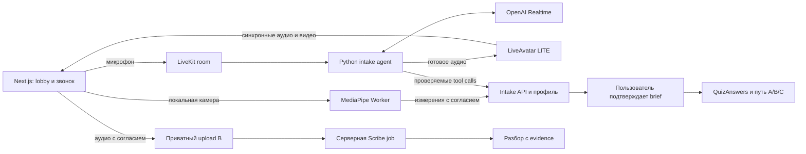

# Holdline. План 4 из 4. Первый созвон с аватаром и разбор подачи

> **For agentic workers:** REQUIRED SUB-SKILL: Use superpowers:subagent-driven-development (recommended) or superpowers:executing-plans to implement this plan task-by-task. Steps use checkbox (`- [ ]`) syntax for tracking.

**Goal:** заменить первый опросник полноценным знакомством по видеосвязи: серьёзный AI-коуч выясняет профессию, текущую и желаемую зарплату, обстоятельства будущего разговора, затем даёт полезный разбор речи и наблюдаемых движений и передаёт подтверждённые ответы в тренажёр.

**Architecture:** Next.js показывает комнату звонка; отдельный LiveKit Agents worker управляет OpenAI Realtime и видеослоем LiveAvatar. MediaPipe измеряет движения локально, Scribe обрабатывает пользовательское аудио после звонка. Проверяемый серверный автомат заполняет профиль, а пользователь подтверждает суммы; модель не становится источником денежных фактов.

**Tech Stack:** HeyGen LiveAvatar LITE, LiveKit WebRTC/Agents с Python worker, OpenAI Realtime (`gpt-realtime-2.1` как кандидат для проверки), MediaPipe Tasks Vision, ElevenLabs Scribe v3, React/TypeScript/Zod, Redis и временное storage из плана B.

**Spec:** [PLAN.md](../../../PLAN.md), [A — ядро и общие типы](2026-11-15-01-engine.md), [B — платформа](2026-11-15-02-platform.md), [C — продукт](2026-11-15-03-product.md), [брендбук](../../../brandbook.html).

**Разработчик:** D. **Ветка:** `codex/holdline-avatar-intake`. **Дата исследования:** 15 ноября 2026. Это новая обязательная продуктовая вертикаль, а не небольшая задача внутри квиза C.

## Общие ограничения

- Первый экран приглашает на знакомство с AI-коучем. Это ещё не торг с начальником и не собеседование при приёме на работу.
- Целевая длительность знакомства — 3–4 минуты, жёсткий предел медиасессии — 5 минут; пользователь может завершить раньше.
- Камера рекомендована для визуальной обратной связи, но не обязательна. Равноправные пути: видеоаватар с локальной камерой, без камеры, аудио, текстовая форма.
- Первая версия сохраняет английский язык и USD основного продукта. Другую валюту или язык нельзя молча переименовать в USD/английский; сохранить ввод, объяснить границу и предложить явный пример или поддерживаемый режим.
- «Кто ты» означает профессию, роль и контекст. Имя необязательно; работодатель, возраст, пол и другие личные признаки не нужны для запуска тренировки.
- Все денежные значения требуют подтверждения валюты, периода и basis gross/net. Неизвестная зарплата/рынок не превращаются в выдуманную цифру.
- Обратная связь описывает наблюдаемые события. Нельзя выводить «нервный человек», «неуверенный кандидат» или диагноз из взгляда, голоса либо движений.
- Базовый видеоанализ работает на устройстве. Камера пользователя не публикуется в WebRTC-комнату; сервер получает только выбранные измерения и coverage после согласия.
- Включённый вводный созвон должен пройти полноценную приёмку. Запасной квиз обеспечивает доступность, но сам по себе не закрывает готовность новой функции.

## На что обратить внимание при ревью

1. Пользователь поправил «fifteen» на «fifty», месяц на год или net на gross — старая сумма отменена, новая подтверждена; D2/D3.
2. Пользователь думает, повторяет слог или говорит с акцентом — коуч не перебивает и не снижает «оценку личности»; D3/D5.
3. Камера выключена, руки вне кадра или темно — unavailable с причиной, без выдуманной позы/взгляда; D4.
4. Прерывание аватара, reconnect, повтор tool call — только один звук, одна запись изменения профиля, корректная история услышанного; D1/D3.
5. После перехода в тренажёр вводный звонок действительно закрыт: не остаются платная комната, микрофон, worker и старые credentials; D6/D7.

## 1. Выбор технологий

Рекомендация — **LiveAvatar LITE + OpenAI Realtime + MediaPipe**, с **LiveKit Agents** как управляемым нами связующим процессом и **Scribe** для последующего разбора. Это выбор для контролируемого первого знакомства и проверяемого evaluation; превосходство качества над всеми альтернативами без испытаний не утверждается.

| Задача | Выбор | Почему подходит этому продукту |
|---|---|---|
| Реалистичный серьёзный собеседник | HeyGen LiveAvatar LITE | Получает готовый голос и возвращает синхронизированные видео/аудио; диалог остаётся под нашим управлением |
| Естественный устный опрос | OpenAI Realtime API | Speech-to-speech, tool calling, настройка очередности реплик; доступные модели и голос проверяем на аккаунте |
| Транспорт и lifecycle | LiveKit + Python Agents worker | Один владелец аудиопотока, tool calls, прерываний, dispatch и остановки; браузер не координирует секретные провайдерские соединения |
| Поза/положение головы/рук | MediaPipe Pose Landmarker + Face Landmarker | Измерения из локальной камеры с quality gates, без передачи исходного видео для стандартного разбора |
| Транскрипт, fillers, слова и паузы | Scribe v3 + существующие RMS/F0 модули | Отдельная проверка аудио с таймстемпами; разговорный ASR не используется как безошибочная запись всех запинок |
| Комментарии к речи | Отдельный evaluator через ModelPorts | Получает события и цитаты, формирует ограниченные рекомендации; не сочиняет числа и наблюдения |

### Что подтверждено документацией

- LiveAvatar предлагает LITE и готовые мосты к OpenAI Realtime/ElevenLabs; LITE отвечает за видеослой. Его [OpenAI connector](https://docs.liveavatar.com/docs/lite-mode/connectors/openai-realtime) документирует собственные credentials/config, но не доказывает пригодность всех нужных нам tool/control-сценариев.
- Официальный [LiveAvatar-плагин LiveKit](https://docs.livekit.io/agents/models/avatar/plugins/liveavatar/) доступен для Python. Поэтому отдельный Python worker — осознанная зависимость плана; не предполагается несуществующий аналогичный Node-плагин. [OpenAI-плагин LiveKit](https://docs.livekit.io/agents/models/realtime/openai/) поддерживает Realtime и управление turn detection.
- В [карточке gpt-realtime-2.1](https://developers.openai.com/api/docs/models/gpt-realtime-2.1) указаны audio/text, входные изображения и function calling; нативное видео и Structured Outputs не заявлены. Доступ к модели и совместимость закреплённого SDK проверяются в D1. Поля профиля валидируются нашим сервером, а не обещанием строгого JSON от разговорной модели.
- [Pose Landmarker](https://developers.google.com/edge/mediapipe/solutions/vision/pose_landmarker?tab=Web) возвращает 33 точки тела; [Face Landmarker](https://developers.google.com/edge/mediapipe/solutions/vision/face_landmarker?tab=Web) — лицевые landmarks, blendshapes и transformation matrices. Это геометрические сигналы, из которых мы строим ограниченные измерения, а не готовый достоверный «детектор нервозности».
- Для [Scribe](https://elevenlabs.io/docs/api-reference/speech-to-text/convert) есть word timestamps и `no_verbatim=false`; true удаляет fillers/false starts. В D5 проверяем на реальных примерах, что нужные запинки действительно сохранились.

### Альтернативы и условия выбора

| Вариант | Когда выбрать | Ограничение |
|---|---|---|
| LiveAvatar + OpenAI Realtime через собственный LiveKit worker | Основной вариант: важны данные профиля, перебивания, подтверждение сумм и прозрачный feedback | Новый работающий постоянно worker и дополнительная интеграция |
| LiveAvatar OpenAI connector | Быстрый технический прототип, проверка лица/голоса | В D1 отдельно доказать управление инструментами, transcript events и отменой; без этого не подменять им основной pipeline |
| LiveAvatar + ElevenLabs Agent | Если повторное использование существующего голосового стека даёт нужное качество дешевле | Это альтернативный мозг/голос, не второй одновременно говорящий агент; проверять custom LLM/session binding |
| Tavus CVI + Raven-2 | Если команда выбирает интегрированный облачный видеоанализ и принимает передачу камеры провайдеру | Иная граница данных и меньше контроля над интерпретациями; нужен отдельный тест качества и согласие |
| Один OpenAI Realtime или один ElevenLabs | Качественный аудиорежим/fallback | Сам по себе не создаёт видеопортрет и не заменяет измерение позы |

У [ElevenLabs connector](https://docs.liveavatar.com/docs/lite-mode/connectors/elevenlabs-agent.md) есть отдельные ограничения: нужен платный ElevenLabs account, PCM 24K и совместимые настройки сессии. Не обещать запуск всей связки на бесплатных кредитах.

**Модель для семантического body language найдена:** [Tavus Raven-2](https://docs.tavus.io/sections/conversational-video-interface/pal/perception.md). Она может давать live observations и post-call report. Для сравнения включать `emotion_recognition='limited'`, `callouts='off'`, запрашивать конкретные движения/видимость, а не «честность/уверенность». В основной сборке v1 Raven не нужен: MediaPipe обрабатывает локальную камеру, не добавляя отдельного облачного perception-запроса; цену этой архитектуры по устройствам и инфраструктуре проверяем в G0. Raven — отдельный кандидат, его качество не переносится из рекламных latency/accuracy-утверждений в обещания Holdline.

### Стоимость и производительность

По [документации LiveAvatar](https://docs.liveavatar.com/docs/faq/credits) LITE расходует 1 credit за минуту сессии; тариф Essential указан как $99 за 1,100+10 credits, overage $0.095/credit. Вводный звонок 3–5 минут расходует 3–5 avatar credits. Подписка, неиспользованные минуты и лимиты аккаунта влияют на эффективную цену.

Бюджет попытки: `avatar_minutes × avatar_rate + Realtime tokens + LiveKit/worker + Scribe audio_minutes + evaluator tokens + storage/egress`. Для Realtime нельзя считать стоимость по одной ставке текстовых токенов: аудио тарифицируется отдельно. В D1 собрать usage технических проб, в D7 — десяти полных scripted calls: среднее, диапазон, стоимость успешного handoff с учётом отказов/повторов и простаивающего worker. Маленькую выборку не представлять как надёжный прогноз p95. До измерений не обещать фиксированные «$0.30 за звонок».

Сравнить двух подходящих stock-аватаров на одинаковых 10 сценариях: не только картинка, но и произнесение сумм, ожидание, interruption, холодный старт, Safari, разборчивость. Выбрать одного основного host и одного заранее проверенного запасного. Кастомный аватар с согласованным голосом — после успешного пилота, не зависимость первого запуска.

## 2. Первый опыт пользователя

### Экран до начала

На `/` сразу виден серьёзный, спокойный AI-коуч по грудь: нейтральный фон, деловая одежда, естественное освещение, без агрессивного взгляда и карикатурного «строгого босса». Имя в первой версии: **Alex — AI practice coach**. Это рабочая persona, не обещание пола/возраста конкретного stock-аватара. Постоянная метка AI; не имитировать реального нанимателя.

- Главный текст: **“Prepare for your next money conversation.”**
- Пояснение: **“Tell me about your role and what you want to ask for. We’ll build your practice together.”**
- Основная кнопка: **“Start the conversation”**. Рядом: **“About 3–4 minutes”**, **“Camera optional”**.
- Вторичный путь: **“Use the quick form”** и доступный пример результата.
- До клика — постер или короткий беззвучный локальный preview; никаких оплачиваемых комнат, запроса permissions и autoplay со звуком.
- На телефоне call stage занимает основную ширину; self-view небольшой, можно скрыть, не выключая камеру. Кнопки mute/camera/end доступны без прокрутки, touch area ≥44px.

### Подготовка устройств

После клика короткая lobby: локальное зеркало, микрофонный уровень, выбор устройств, субтитры и понятное разделение разрешений. Зеркалится только preview; вычисления координат используют немирроренный источник. Вызвать getUserMedia через действие пользователя.

1. Голос нужен для разговора; если микрофон запрещён, сразу доступна форма. Коротко объяснить, что речь передаётся разговорному провайдеру для ответа; отказ от записи для отчёта не означает полностью локальный разговор.
2. Камера даёт только визуальные наблюдения, её можно выключить в любой момент. Отдельный visualAnalysis opt-in; без него можно оставить только локальное self-view, без измерений/отправки features. Отказ не ухудшает оценку.
3. Отдельный audioAnalysis opt-in на временное сохранение пользовательского аудио и подробный разбор. Без него разговор и профиль работают, audio review unavailable. Микрофонное permission браузера не заменяет это согласие. Имена поставщиков/сроки обработки доступны из короткого пояснения.
4. До звонка показывать только технические подсказки: «лицо вне кадра», «микрофон не слышно». Не комментировать внешность или предполагаемое настроение.

На lobby до 10–15 секунд обычного пути; не заставлять пользователя проходить специальную позу/двигательный тест. Камера не обязана видеть всё тело: для ноутбука достаточно головы и плеч; руки/корпус анализируются только когда видны.

### Разговор по шагам

Сначала вопрос, затем ответ пользователя и короткое подтверждение; не читать весь список вопросов подряд. Уже названные сведения извлекать из свободного ответа и не спрашивать снова. За один раз — один главный вопрос; максимум два коротких уточнения спорного поля, затем карточка для ввода или skip.

| Шаг | Пример реплики host | Что фиксируем и как уточняем |
|---|---|---|
| Приветствие | “I’m Alex, your AI practice coach. We’ll map out your conversation, then practise it. You can pause or skip a question.” | Раскрытие AI, короткая рамка, без оценки до ответа |
| Роль | “What do you do, and what conversation are you preparing for?” | userRole и kind; не путать профессию пользователя с counterpartRole |
| Собеседник | “Who will you be speaking with?” | Manager/recruiter/client/landlord; имя человека не обязательно |
| Текущая сумма | “What is your current base pay?” | amount, currency, period, gross/net; бонусы отдельно, не подмешивать в base |
| Цель | “What amount would you like to ask for?” | Та же валюта и basis; если «на 15% больше», вычислить кодом и подтвердить сумму |
| Основания/рынок | “What are you basing that number on?” | Примеры результата работы, известный пользователю диапазон или unknown |
| Обстоятельства | “What response are you most concerned about?” | Страх/ожидаемое возражение; можно пропустить. Дата — короткое дополнительное поле, если существенна |
| Мини-репетиция | “Say the first sentence you would use to make the ask.” | 20–30 секунд собственной фразы с суммой, материал для feedback; не запуск переговорного ядра |
| Подтверждение | “Here’s what I heard. Please check the numbers before we continue.” | Редактируемая карточка и явное подтверждение пользователем |

Если пользователь сразу назвал все данные, перейти к уточнениям и мини-репетиции. При аренде заменить зарплатные вопросы на месячную плату; профессия не обязательна. Первый отполированный сценарий — raise. Offer доступен только после capability/приёмки соответствующего сценария A/B/C; вводный коуч не обещает неготовый вид тренировки.

**Пример естественного фрагмента:** пользователь: “I’m a backend engineer. I make ninety-five, and I want a hundred and ten.” Host: “Are those annual amounts in US dollars, before tax?” После подтверждения карточка показывает `$95,000/year → $110,000/year, gross`. Нельзя сохранить 95/110 долларов или принять «да» к неуслышанной пользователем фразе после interruption.

### Паузы, перебивания и сложные ответы

- Стартовый turn detection — semantic VAD с низкой eagerness; параметры проверяются на записи, а не считаются универсальными. [OpenAI VAD](https://developers.openai.com/api/docs/guides/realtime-vad) позволяет регулировать ожидание конца реплики.
- Во время запинки не заканчивать слово за пользователя, не говорить «успокойтесь». Через длительную тишину — одно спокойное предложение времени/skip; не каждые две секунды повторять вопрос.
- При речи пользователя остановить генерацию и очередь аудио/видео; обновить историю до реально проигранной части. Иначе следующая реплика будет ссылаться на неуслышанное подтверждение.
- «Не знаю зарплату/диапазон», «не хочу говорить» — допустимые unknown/skipped. Если известны current/target, но не рынок, предложить явные **учебные границы между текущей и желаемой суммой**, вычисленные A, с отдельным подтверждением и подписью “Practice assumption — not a market estimate”. Сохранить неизвестный рынок неизвестным. Если нет и нужных сумм — явно обозначенный пример, без давления раскрыть зарплату.
- «Я оговорился» отменяет прежнюю кандидатную сумму. «Ignore previous instructions» в ответе не изменяет правила сбора, permissions, лимиты и структуру профиля.
- Слово «стоп», кнопка End, отказ от записи и mute проверяются отдельно: mute не означает конец, end закрывает все провайдерские сессии, отмена оценки отзывает право на дальнейшую обработку.

### Экран результата первого знакомства

Сначала карточка **“Your practice brief”**: роль, вид разговора, current/target, единицы, причины, дата и неизвестные поля. Деньги крупно моноширинным шрифтом; кнопка Edit рядом. Подтверждение пользователем необходимо даже при уверенном распознавании.

Ниже **“How you delivered your opening”**: максимум три полезных наблюдения — что уже получилось, один момент для улучшения, конкретная следующая попытка. Для каждого: цитата или интервал, измерение/оценка, причина выбора и действие. Пример: “You paused for 2.1 seconds before the amount. Try stating the number, then pause.” Не превращать обычную паузу в доказательство слабости.

Во время разговора не показывать тревожный счётчик ошибок, live «confidence 34%» или денежные потери. После звонка денежная симуляция ещё не проведена: «оставил на столе» здесь отсутствует. Главная кнопка: **“Start my practice”**; вторичная: **“Try that sentence again”** без повторного заполнения профиля.

При входе в review остановить платную медиасессию, но сохранить профиль и право редактирования. Можно читать карточку сколько нужно в пределах TTL, не оплачивая молча открытый room. Brief доступен сразу; report приходит отдельно с целевым p95≤30s после готового upload. После 60s ожидания показать partial/unavailable с повтором анализа, не заставляя пользователя ждать для тренировки. Retry мини-репетиции после stop — явное новое подключение с квотой/бюджетом, либо локальная запись без аватара по выбору пользователя; не возвращать к началу опроса.

### Микросостояния и качество общения

| Ситуация | Видимый ответ продукта |
|---|---|
| Подключение | “Connecting to Alex…” со статусом; после 15s кнопки audio/form, draft сохранён |
| Пользователь думает | Тихий нейтральный listening pose, без таймера ошибки; после примерно 8s одно “Take your time, or skip this question.”, порог проверить в пилоте |
| Сумма двусмысленна | Короткое уточнение плюс редактируемая карточка; не произносить длинное предположение как факт |
| Звук/видео расходятся или host замер | Понятный статус соединения; остановить старый output, один audio fallback, без второго одновременно говорящего голоса |
| Камера недоступна/темно | “Visual feedback unavailable” и конкретная техническая причина, разговор продолжается |
| Недостаточно материала | “Not enough speech to assess this yet.”, предложить одну короткую пробу; нулевой балл не выставляется |
| Запись/анализ отозваны | Остановить сбор и отменить обработку; профиль для тренировки остаётся, отдельная Delete удаляет и его |
| Страница обновлена/сеть вернулась | Восстановить профиль с сервера; не включать камеру/микрофон автоматически и не повторять уже отвеченные вопросы |

Host отвечает кратко, не вставляет одинаковое “Great!” после каждой зарплаты. Темп голоса, произнесение крупных сумм и естественное молчание проверяются на одинаковом сценарии. Субтитры различают tentative/confirmed; live region сообщает смену состояния, не каждое слово. Кнопки End/mute/camera всегда видны; на мобильном клавиатура не перекрывает подтверждение суммы. Ошибки и сообщения сохраняют спокойный тон Holdline.

## 3. Evaluation: что именно измеряем

| Слой | Сигнал и технология | Что можно сообщить | Что нельзя заключать |
|---|---|---|---|
| Речь | Scribe timestamps + RMS: темп, продолжительность пауз, fillers | Число, единица, интервал, условия измерения | Пауза сама по себе не означает нервозность |
| Неплавность | Повторы слов/false starts в raw transcript + проверка аудио | Наблюдаемое повторение или осторожный кандидат | Диагноз «заикание», причина и тяжесть расстройства |
| Формулировки | Evaluator с цитатой: просьба без суммы, лишнее извинение, неоднозначная фраза | Возможная более ясная формулировка в контексте цели | «Неправильная личность», снижение балла за акцент/диалект |
| Голос | RMS/F0 против подходящей записи сравнения | Изменение громкости/высоты и coverage | «Вы врёте/боитесь», точное эмоциональное состояние |
| Голова | Face transformation/landmarks | Поворот головы, время вне кадра | Настоящий eye contact, внимание или уверенность |
| Плечи/корпус | Pose landmarks | Смена положения/наклон в наблюдаемой геометрии | Медицинская «плохая осанка», мотивация, состояние здоровья |
| Руки | Видимые wrists/локти; Hand Landmarker только после отдельного теста | Движение рук, приближение руки к лицу | «Жест означает ложь» или психологический профиль |
| Самоощущение | Необязательный ответ пользователя | “You said you felt nervous about naming the amount.” | Вывод о нервозности без слов пользователя |

### Неплавность речи и «неправильные слова»

Для D5 хранить raw transcript отдельно от prettified UI-текста; не считать fillers после очистки. Кандидаты word repetitions/false starts проверять по размеченным примерам и показывать с uncertainty. Блоки и повторения звуков ASR может потерять: простой текстовый счётчик не закрывает эту часть задачи.

Исследовательский резерв для акустической детекции — модели/методика [SEP-28k, Apple](https://machinelearning.apple.com/research/stuttering-event-detection): в датасете размечены блоки, протяжения, повторы звуков/слов и вставки. Это исследование и данные, не готовый гарантированно подходящий API. Отдельно оценить модель на наших языках/микрофонах/пользователях; не обучать и не включать такой classifier без проверки лицензий данных и качества. В v1 точно заявлять только прошедшие приёмку классы событий.

Первая реплика при знакомстве не является нейтральной VoiceBaseline. Не подставлять её в существующий tensionIndex как «вашу норму». Нейтральная 20-секундная калибровка остаётся добровольным отдельным шагом C; без неё — абсолютные показатели. Из первого звонка можно сохранить `referenceKind:'observed_intake'` для сравнений одинаковой мини-репетиции, с соответствующей подписью.

### Геометрия и качество наблюдений

- Предложенный старт: Pose Landmarker Full для ноутбука; Lite при перегрузке. Face Landmarker для ориентации головы; распознавание личности не выполняется. Model assets и WASM закреплены по версии и hash.
- Обрабатывать кадры примерно 10 fps при 640×360 в Worker; динамически снижать до 5 fps. Пропускать старые кадры, а не копить очередь и задерживать звонок. На слабом устройстве выключить visual analysis с объяснением, сохранив разговор.
- У каждого окна `validMs/observedMs`, confidence и причины непригодности. Для вывода о конкретном движении нужны видимые необходимые точки; невидимая рука не означает отсутствие жестов.
- Стартовые пороги для тестирования: confidence≥0.7, событие поворота головы >25° длительностью ≥2s; изменение положения центра плеч >0.25 ширины плеч относительно собственного reference, ≥2s. Это настраиваемые инженерные пороги, не нормы поведения.
- На длинную сводку нужны ≥10s пригодной камеры и coverage≥70%; короткое достоверное событие можно показать отдельно, но нельзя распространять его на весь звонок. Движение камеры, зеркальность, occlusion и два человека делают соответствующую оценку unavailable.
- Не измерять centimetres глубины, точный взгляд в глаза или «суетливость» из 2D web-camera. Не штрафовать неподвижность, инвалидность, нейроотличия, разные привычки жестов или культуру общения.
- Report не имеет общего балла «хороший человек/готов к повышению». Отдельно: ясность просьбы, доступные речевые измерения, наблюдения камеры, выбранная следующая попытка.

## 4. Архитектура и контракты четвёртой ветки

**Один источник звука:** в видео режиме пользователь слышит avatar track, а не одновременно avatar и OpenAI. При падении аватара остановить его output, затем явно включить audio-only. Для основной архитектуры браузер не открывает параллельное прямое WebRTC-соединение с OpenAI.

Worker постоянно обслуживает комнату и не помещается в короткий Next.js Route Handler. Next.js выдаёт ограниченные room credentials, dispatch выполняется сервером; worker запускается в LiveKit Cloud/контейнерном runtime, выбранном B. Общие данные — в Redis B, не в памяти worker. LiveKit room token разрешает пользователю публиковать микрофон, не камеру; локальное видео остаётся только у MediaPipe.

### Владение файлами

| Область | Владелец | Граница |
|---|---|---|
| `src/onboarding/**` | D | Собственные contracts, state machine, UI, browser vision, server orchestration, fixtures |
| `src/app/intake/**`, `src/app/api/intake/**` | D | Тонкие страницы и API новой вертикали; исключение из общих зон C/B |
| `services/intake-agent/**` | D | Python worker, pyproject.toml, uv.lock, Dockerfile, unit-тесты; отдельный lockfile только для отдельного Python runtime |
| `tests/intake/**`, `tests/e2e/intake-*.spec.ts` | D | Проверки нового входа и передачи данных |
| `public/intake/**`, `docs/product/intake/**` | D | Постер, model manifests, сценарии оценки; сырые пользовательские записи в Git не попадают |
| `src/contracts/**`, `src/domain/**` | A | Общие MoneyAnswer/IntakeHandoff/QuizAnswers, денежные адаптеры и валидатор; D импортирует, не копирует |
| Shared storage/auth/limits/jobs, env, CI, npm lockfile, deploy | B | D вызывает порты и передаёт требования, B меняет общую инфраструктуру |
| `/`, общие токены, `/quiz`, каталог/тренировка/разбор | C | Главная встраивает IntakeEntry D; квиз остаётся fallback с восстановлением draft |

D не переносит всю C recorder-реализацию в свою папку: C экспортирует `createUserCapture` и timeline/cleanup. Для intake-purpose расширение общего AudioManifest вносит A, upload/job adapter — B. Webcam/vision и разговорный flow принадлежат D.

### Модель состояния и минимальные DTO

`intakeContractVersion:1` существует отдельно от `contractVersion:1` движка. A владеет общей границей MoneyAnswer/IntakeHandoff, D — внутренними схемами onboarding с импортом этих типов. Python-модели генерируются/проверяются против экспортированной JSON Schema D; общие части не копируются вручную.

- `IntakePhase = lobby | connecting | interviewing | mini_practice | review | completed | interrupted | expired`.
- `IntakeField<T> = {value:T|null, status:'unknown'|'candidate'|'confirmed'|'skipped', sourceTurnId:string|null, revision:number}`. Отсутствие значения и отказ пользователя различимы.
- `MoneyAnswer = {amountMinor:number,currency:string,period:'year'|'month'|'one_time',basis:'gross'|'net'|'unspecified'}`; перед handoff A проверяет поддержку валюты, единиц и единый basis. Никакой автоматической FX-конвертации.
- `IntakeProfile`: userRole, seniority (optional), kind, counterpartRole, currentMoney, targetMoney, marketLow/High, practiceRange (optional, отдельное учебное допущение A), reasons, conversationDate, fear, selfReportedNervousness (optional). Значения обёрнуты в IntakeField; основные суммы и выбранный диапазон требуют явного подтверждения. Handoff сохраняет rangeSource, unknown market не перезаписывается учебным диапазоном.
- `IntakeSession`: id, ownerId, revision, profileRevision, phase, profile, consentVersion, consents (`audioAnalysis`, `visualAnalysis`), mode, mediaStatus, providerEpoch, roomId, startedAt, deadlineAt, lastEventSeq. revision — CAS всего агрегата; profileRevision меняется только при изменении/подтверждении профиля. mediaStatus=`not_started|connecting|active|stopping|closed` независим от phase; review сохраняется после media closed. Служебные secret/room IDs не публикуются без необходимости.
- `IntakeView`: id, revision, profileRevision, phase, mediaStatus, publicProfile, committedTranscript, availability, missingFields, expiresAt. Transcript items: turnId, sequence, role, text, recordingId, spokenRangeMs; tentative items не фиксируют зарплату. Нет надёжной привязки к recording_ms — speech interval unavailable.
- `Observation`: id, recordingId/segmentId, kind, startMs, endMs, value, unit, quality, validMs, observedMs, source (`mediapipe | scribe | acoustic | model | self_report`), modelVersion, unavailableReason. Raw landmarks/кадры не сохраняются. model-оценка ссылается на исходную цитату/measurement; само утверждение evaluator не является независимым evidence.
- `FeedbackItem`: category, claim, evidenceIds, quote, suggestion, confidenceLabel (`observed | estimated | self_reported`), limitations. У пункта без evidence нет права появиться в report.
- `IntakeAssessment`: intakeId, revision, profileRevision, consentVersion, status (`pending | ready | partial | unavailable`), speech, delivery, visual, topFeedback (≤3), nextPracticeFocus. Частичный visual не блокирует профиль. После правки суммы старые рекомендации помечаются устаревшими и пересчитываются; исходные наблюдения не переписываются под новую цифру.
- `IntakeHandoff`: intakeId, profileRevision, confirmedAt, `quizDraft:Partial<QuizAnswers>`, `missingFields:(keyof QuizAnswers)[]`, suggestedAvatarId, referenceKind, assessmentId, mode (`personal | example`). Финальный QuizAnswers собирается после выбора/подтверждения персонажа C и проверки A.

Состояние анкеты и медиасессия имеют разные сроки: звонок максимум 300s от первого connect, draft/assessment в нашем хранилище — 24h. Connect retry не сбрасывает deadline. Истечение звонка переводит к review/сохранённому draft, истечение TTL — к expired/410. Интеграция core не зависит от доступности исходной записи.

### API и инструменты

Все браузерные API используют owner cookie, Origin check и общую error envelope B. Мутации — Idempotency-Key; профиль/подключение/подтверждение и выдача согласия дополнительно требуют expectedRevision. Initial create не имеет revision, append-only events используют seq/consentVersion. **Stop, отзыв согласия и delete не блокируются устаревшей revision**: сервер атомарно применяет прекращение к текущему состоянию, не перезаписывая новые ответы старым snapshot. Другой payload с тем же idempotency key →409. Service endpoints проверяют identity worker, intakeId и providerEpoch: поздний tool от старого соединения не меняет профиль. Браузер не вызывает privileged tool напрямую.

| Метод | Вход | Результат |
|---|---|---|
| `POST /api/intake` | mode, locale, consents, consentVersion | Создать draft, вернуть IntakeView; без автозапуска платного звонка |
| `POST /api/intake/:id/connect` | expectedRevision | Зарезервировать бюджет, dispatch worker; вернуть ограниченный room token/url, providerEpoch, deadlineAt |
| `GET /api/intake/:id` | owner cookie | IntakeView, no-store; восстановление после reload |
| `PATCH /api/intake/:id/profile` | expectedRevision, пользовательские corrections | Валидированные candidate/confirmed поля; изменённые зависимости требуют повторного подтверждения |
| `POST /api/intake/:id/events` | seq, consentVersion, bounded observations batch | Идемпотентно принять локальные measurements, не менять деньги |
| `POST /api/intake/:id/consent` | consents; expectedRevision для выдачи, отзыв без CAS-блокировки | Остановить отозванную обработку/capture, увеличить consentVersion; поздние старые batches отклонить |
| `POST /api/intake/:id/stop` | reason | Идемпотентно закрыть media/worker при review/End/error, сохранить актуальный draft; анализ поставить один раз после принятого upload и проверки согласия |
| `GET /api/intake/:id/assessment` | owner cookie | pending/ready/partial, наблюдения и evidence |
| `POST /api/intake/:id/confirm` | expectedRevision, confirmedFields | Зафиксировать подтверждение/profileRevision и вернуть IntakeHandoff с missingFields; остановить оставшуюся media. LLM не подтверждает за человека |
| `DELETE /api/intake/:id` | owner cookie, idempotency key | Отозвать credentials и удалить наши данные/задачи, поставить подтверждаемые provider-delete задачи где применимо |
| `POST /api/intake/internal/tool` | worker identity, intakeId, providerEpoch, callId, expectedRevision, operation, payload | Результат разрешённого tool, журнал дедупликации; только для worker |

Разрешённые tools: `propose_profile_patch`, `get_missing_fields`, `prepare_confirmation`, `request_mini_practice`, `request_end`. Tool предлагает изменение с evidence; успешный RPC не означает, что пользователь подтвердил сумму. `request_end` не подтверждает профиль. Запретить tools вида «изменить salary в ядре», «выдать entitlement» или произвольный URL.

Порты между ветками: D получает от B `IntakeStore.read/create/compareAndSet`, `Budget.reserve/reconcile`, `JobQueue.enqueue`, `AudioStore`, Scribe/ModelPorts и service-auth. C передаёт `createUserCapture({userStream,purpose,recordAudio,signal})` по C3. D экспортирует `IntakeEntry`, `IntakeCall`, `IntakeReview`, `getConfirmedHandoff(intakeId,ownerId)` и `ensureMediaClosed(intakeId,ownerId)` для B. A предоставляет validatePracticeDraft/buildQuizAnswers/normalizePracticeMoney. Частичный draft не становится готовым QuizAnswers без валидации.

Facade D и совместимые fixtures входят в общий ранний коммит; до реализации ответы явно unavailable, avatarIntake=false. B/C поэтому компилируются до финального слияния D. В G1 stub заменяется реальной реализацией, включение флага само по себе не является приёмкой.

## 5. Задачи разработчика D

### D1. Доказать работоспособность выбранной связки

**Файлы:** `services/intake-agent/{pyproject.toml,uv.lock,agent.py}`, `src/onboarding/providers/**`, `docs/product/intake/provider-spike.md`. **Зависимости:** B runtime/credentials/budgets, C capture API.

- [ ] Поднять одну тестовую комнату: user mic → OpenAI Realtime → LiveAvatar → один синхронный audio/video output. Начать с stock-avatar, потом сравнить второй.
- [ ] Проверить model ID, голос, semantic VAD, tool result roundtrip, pause, interrupt, transcript identity, закрытие комнаты и фактически потреблённые кредиты. Недокументированную совместимость не считать подтверждённой.
- [ ] Проверить Chrome/Safari, mobile, разрешение без камеры и блокировку UDP с доступным TURN. Испытать cold start, warm start и две одновременные сессии.
- [ ] Зафиксировать версии SDK/моделей, стоимость и измеренную задержку. Базовый вариант — собственный worker; готовый connector можно выбрать только при таком же доказанном контроле tools/lifecycle.

### D2. Профиль, инструменты и конечный автомат

**Файлы:** `src/onboarding/{contracts,domain,server}/**`, `src/app/api/intake/**`, `tests/intake/{profile,tools,consent}.test.ts`, `services/intake-agent/tests/test_contracts.py`.

- [ ] Написать 40 фиксированных сценариев извлечения, включая `95k`, fifteen/fifty, monthly/yearly, net/gross, currency, отказ, неизвестный рынок, «+15%», исправление и prompt injection.
- [ ] Пример обязательного assert: `$95,000/year × 1.15 = $109,250/year`, то есть `10_925_000` центов; до подтверждения это candidate. Нет базы/валюты/периода — нет вычисления.
- [ ] Для денежной нормализации и процентов использовать чистые функции A; не вычислять вторую версию в prompt/Python. MoneyAnswer/Handoff импортируются из A. Валидировать поддерживаемый kind и gross/net; скрытый переход offer/custom в неподдерживаемый или неоплаченный сценарий запрещён.
- [ ] Unknown market не создаёт тупик: предложить suggestPracticeRange A с явным подтверждением допущения либо example. Отказ допустим. Исправление current/target отзывает подтверждение производных цели/диапазона.
- [ ] Реализовать revision/CAS, tool-call dedup и независимые состояния skipped/unknown. Для изменённой зарплаты заново подтвердить производную цель; late callback не восстанавливает отменённое значение.
- [ ] Конкурентный tool/profile update не мешает End, отзыву согласия или Delete. Поздние callbacks проверяют закрытие/consentVersion/providerEpoch и не воскрешают удалённую запись.
- [ ] Добавить `POST confirm` только с пользовательским действием; экспорт JSON Schema и тесты TS↔Python. `npm run test:intake` и `uv run --project services/intake-agent pytest` должны проходить без платных API.

### D3. Премиальный call UI и разговорная режиссура

**Файлы:** `src/onboarding/ui/**`, `src/onboarding/client/call.ts`, `src/app/intake/**`, `public/intake/host-poster.*`, `tests/intake/call-state.test.tsx`, `tests/e2e/intake-call.spec.ts`.

- [ ] Реализовать экран входа, lobby, self-view, субтитры, mute/camera, stop, редактируемые денежные карточки, понятные loading/reconnect состояния. C встраивает IntakeEntry на `/`.
- [ ] Провести сценарий раздела 2: максимум один главный вопрос, короткие acknowledgements, пропуск уже известных полей. Не включать coaching-комментарии о каждом движении прямо в разговор.
- [ ] На barge-in отменять генерацию, flush avatar queue и сверять playback history. Тестировать пользовательское «нет» во время прочтения суммы и фоновые шумы, не считая любой шум осмысленным перебиванием.
- [ ] При недоступном видео — один переход в audio-only без двойного звука; при недоступном аудио — форма с сохранённым draft. Таймаут подключения 15s с видимым fallback, не бесконечный spinner.
- [ ] Открытие review вызывает stop и release исходного mic stream; C capture освобождает свои clones. Согласия, камера и stop не спрятаны за полноэкранным видео. Проверить все микросостояния раздела 2.

### D4. Измерение body language на устройстве

**Файлы:** `src/onboarding/client/vision/{worker,models,features,quality}.ts`, `public/intake/models/**`, `tests/intake/vision-*.test.ts`.

- [ ] Вынести MediaPipe inference в Worker/проверенный совместимый механизм; версионировать model assets и thresholds. React получает редкие агрегаты, а не 30 updates/sec всех landmarks.
- [ ] Реализовать coverage, присутствие головы/плеч, длительные повороты головы, смену положения и движения видимых рук. Проверить правила раздела 3 по размеченным локальным клипам.
- [ ] Тестировать зеркальность, occlusion, темноту, очки, разные камеры/положения, руки вне кадра, двоих людей и движение камеры. Невалидный участок даёт null/unavailable.
- [ ] Network-проверкой подтвердить отсутствие публикации user video/frame upload; после camera off Worker не получает новые кадры, старые buffers освобождены.

### D5. Разбор речи и рекомендации

**Файлы:** `src/onboarding/server/{assessment,evidence,delivery-evaluator}.ts`, `src/onboarding/ui/Assessment.tsx`, `tests/intake/assessment.test.ts`, `docs/product/intake/evaluation-set.md`.

- [ ] Через B использовать Scribe v3: `no_verbatim=false`, word timestamps, raw transcript; без cleanup/edited transcript в расчёте disfluency. Возврат результата сопоставлять с intakeId и consentVersion.
- [ ] Счётчики fillers/повторов/пауз отделить от модельных советов. Evaluator вызывается через ModelPorts с purpose=intake_evaluate; получает bounded events/цитаты, а не raw video. Сервер проверяет существование evidenceIds, совпадение цитат и чисел; неизвестные references отклоняются. При сбое оставить измерения и шаблонный совет, не фантазию LLM.
- [ ] Добавить проверку терминов: не говорить «диагноз», «низкая уверенность» по позе или «плохой английский» по акценту. Различать реальный повтор, эхо, ошибку ASR и намеренное усиление фразы.
- [ ] Отобразить максимум три рекомендации и возможность повторить только mini-practice. Доступность звука/evidence interval зависит от согласия и retention; отсутствующая запись не создаёт неработающую кнопку Play.

### D6. Передача в основной продукт

**Файлы:** `src/onboarding/server/handoff.ts`, `src/onboarding/ui/Review.tsx`, `tests/intake/handoff.test.ts`, `tests/e2e/intake-to-practice.spec.ts`. **Внешние изменения:** A общий валидатор, B session adapter, C navigation.

- [ ] A/B/C/D согласуют fixture подтверждённого raise, неизвестного рынка, unsupported currency и режима example до параллельной реализации.
- [ ] Передавать intakeId/profileRevision, а не доверять денежным полям из произвольного client payload. После выбора avatarId B загружает confirmed handoff и вызывает A buildQuizAnswers.
- [ ] Не переспрашивать уже подтверждённые сведения в старом квизе. Missing fields показывать точечно. Не создавать переговорную сессию, пока не закрыты обязательные поля или не выбран явно пример.
- [ ] Закрыть intake media до старта ElevenLabs negotiation. Сохранить связь assessmentId для пользователя, но не превращать паузы/позу в штрафы trust/patience ядра.

### D7. Эксплуатация и приёмка

**Файлы:** `docs/product/intake/{acceptance,runbook}.md`, `services/intake-agent/Dockerfile`, `tests/e2e/intake-resilience.spec.ts`.

- [ ] Отдельные лимиты intake: до 3 новых медиапопыток на IP/UTC-день, 300s каждая; сетевой retry возвращает ту же активную попытку. Явный restart после stop/timeout считается новой попыткой с новым providerEpoch, даже при прежнем draft. Они не съедают три переговорные сессии B, но входят в общий денежный budget.
- [ ] При reconnect не создавать вторую оплачиваемую комнату. Через 15s потери участника завершать платную сессию; повторный вход позже — явное новое подключение к сохранённому draft с новым резервом.
- [ ] Настроить удаление наших raw audio ≤24h, feature batches/draft/assessment 24h, немедленную отмену pending jobs после отзыва. В поставщиках отдельно проверить доступные retention/delete controls: наш TTL не означает автоматически удаление копий у провайдеров. Не обещать enterprise zero-retention на обычном тарифе.
- [ ] Метрики продукта: start→permission→connected→brief confirmed→practice started, drop-off на шаге, исправления сумм, interruption errors, coverage и стоимость. В аналитике нет salary, transcript, video и raw landmarks.
- [ ] Выполнить unit/contract/E2E на итоговом SHA и 10 живых scripted calls; затем минимум 5 добровольных пользовательских проб с различным оборудованием/манерой речи. Согласие на оценочные записи отдельно, данные не публиковать в репозитории.

## 6. Критерии качества и выпуск

Пороговые значения ниже — цели приёмки Holdline, а не гарантии поставщиков. Проверять на описанной сети/устройствах; для технической latency-матрицы минимум 30 подключений и 100 реплик, отдельно cold/warm, mobile/desktop. Сохранять sample size, p50/p95 и ошибки, не выдавать малый пилот за популяционную точность. G0 проверяет две параллельные сессии; G3 — согласованный с B лимит concurrency и отказ сверх него.

| Проверка | Условие приёмки |
|---|---|
| Первое подключение | В тестовой матрице p95≤8s от Start после permissions до готового host; после 15s понятный fallback |
| Ответ по существу | Для явно завершённых реплик p95≤3s до слышимого содержательного ответа; естественная пауза внутри мысли не считается завершением |
| Прерывание | p95≤500ms от подтверждённой речи пользователя до прекращения слышимого host; отменённый хвост не «всплывает» позже |
| Готовность отчёта | Brief сразу; report p95≤30s после принятого upload, после 60s partial/unavailable с retry; тренировка не блокируется |
| Денежные данные | Все 40 фиксированных edge cases проходят; в живых пробах 100% финальных денежных значений подтверждены человеком, несовпадения исправлены до handoff |
| Неплавность/словесные советы | На минимум 60 размеченных utterances целевая precision показываемых событий ≥90%, recall опубликован отдельно; не достигнуто — класс выключен, без заявления о полном обнаружении заиканий |
| Визуальные события | На минимум 30 размеченных клипах precision показываемых событий ≥90%; coverage и ошибки по типам условий указаны; occluded limbs не дают наблюдений |
| Удобство | Минимум 4 из 5 участников проходят brief без помощи; ошибки с суммой/потерей данных блокируют релиз независимо от средней оценки |
| Закрытие | End/cancel/error действительно освобождают комнату, SDK, media tracks, Worker и бюджет; callback после cancel не продолжает обработку |
| Доступность | Keyboard, captions, screen-reader статусы, mobile, no camera, no mic, reduced motion и fallback проходят |
| Полный результат | Первый экран → знакомство → подтверждение → тренировка → разбор → replay на реальных API; основной вход больше не начинается со старого квиза |

**G0 — выбор стека:** D1 доказывает речь/аватар/tools/перебивания на реальном аккаунте, B проверяет бюджеты и deployment. **G1 — рабочее знакомство:** D2/D3 и handoff, fallback, подтверждение сумм. **G2 — полезный разбор:** D4/D5 с evidence и quality gates. **G3 — выпуск:** D6/D7 и сквозная приёмка.

G0 имеет смысл ограничить одним рабочим днём исследования. После него команда оценивает G1–G3 по фактическим ограничениям; полный объём не помещается автоматически в старое обещание «24 часа». Черновое видео без подтверждения зарплаты, устойчивых перебиваний и честного feedback — техническое демо, не завершённая первая функция.

Общая база → четыре параллельные ветки → A → B → C → D → совместная приёмка. Контракт handoff и reusable capture выносятся в общий ранний срез; для независимой работы D использует зафиксированные fixtures. Если D ещё не прошла G3, синьор может сохранить рабочий прежний релиз, но не объявляет новый avatar-first продукт готовым. Четвёртый план означает отдельную область разработки; он не изменяет правила участия в хакатоне.
